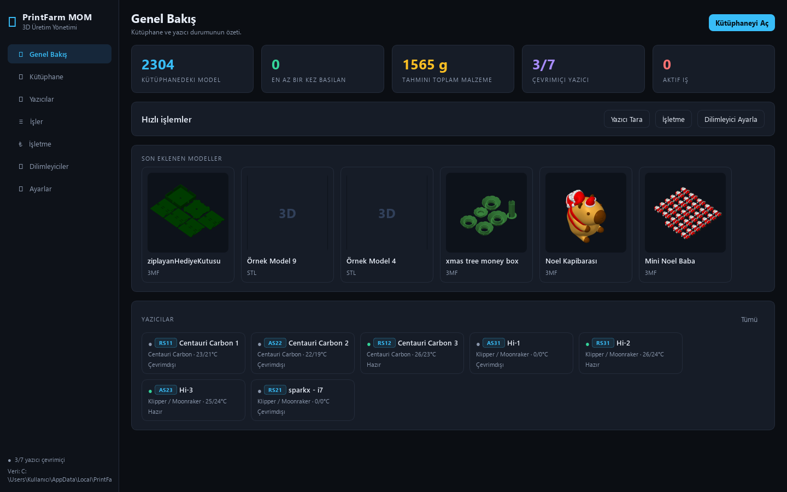
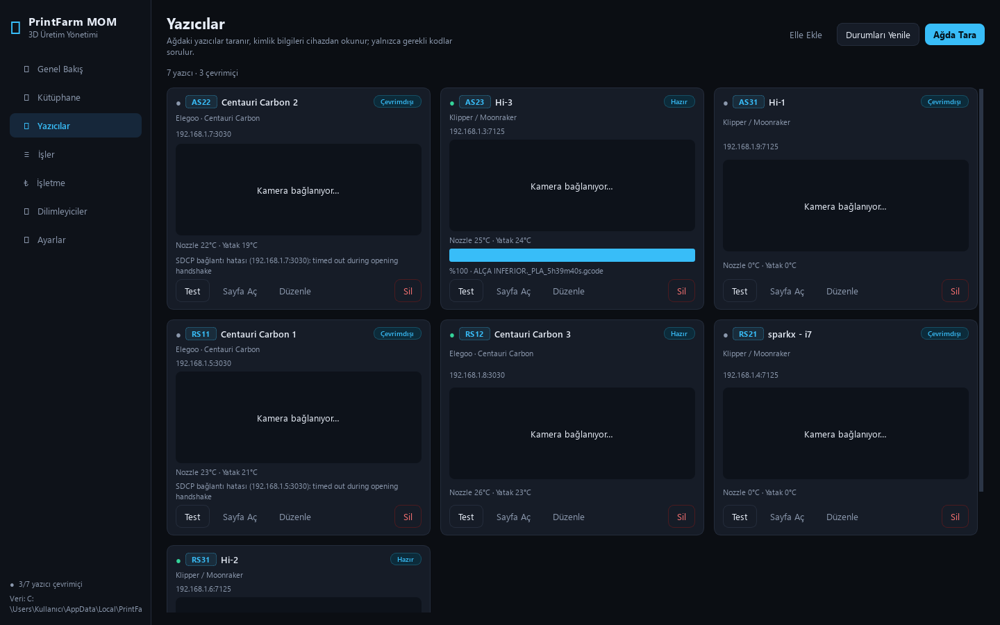
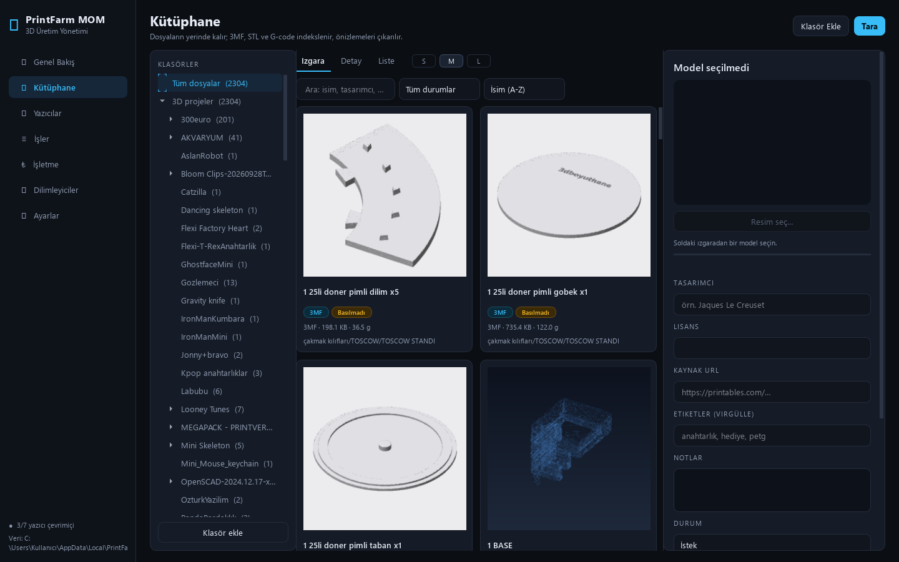
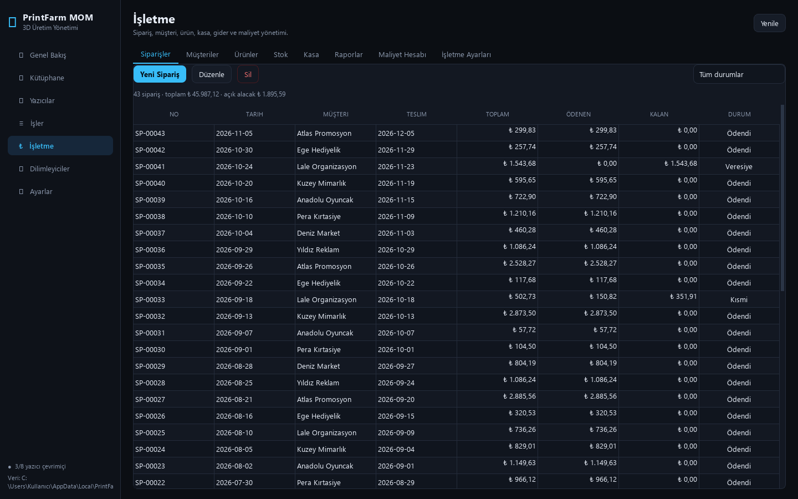
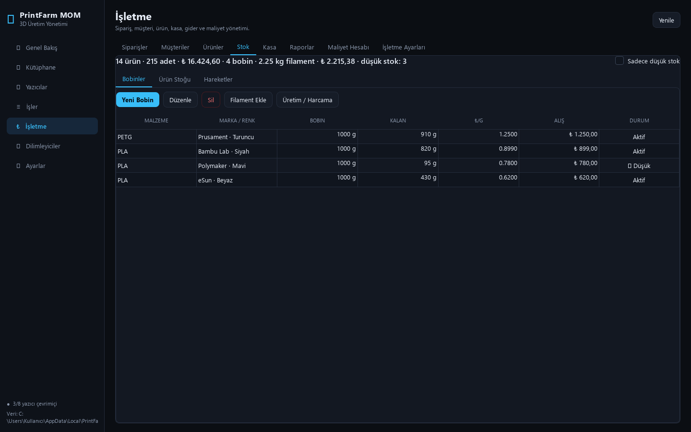

# PrintFarm MOM

**3D yazıcı çiftliğinizi tek ekrandan yönetin.**

PrintFarm MOM (Manufacturing Operations Management), birden fazla 3D yazıcıyla üretim yapan
atölyeler için hazırlanmış bir Windows uygulamasıdır. Bambu Lab, Prusa, Creality, Elegoo,
Snapmaker ve Klipper tabanlı yazıcıları tek arayüzde toplar; model arşivini, baskı kuyruğunu,
filament stoğunu ve sipariş/maliyet hesaplarını aynı programda yönetmenizi sağlar.

Kurulum gerektiren bir sunucu, bulut hesabı veya internet bağlantısı yoktur: program yazıcılara
doğrudan yerel ağdan bağlanır, tüm veriler kendi bilgisayarınızda kalır.

> Bu depo **yalnızca dağıtım** için kullanılır. Kaynak kodu paylaşılmaz; program kurulum
> dosyası olarak GitHub Releases üzerinden sunulur.

## İndirme

**En son sürüm:** [GitHub Releases — en son sürüm](https://github.com/ozturkweb/printfarm-mom/releases/latest)

Sürüm sayfasındaki **Assets** bölümünde şu dosyalar bulunur:

| Dosya | Açıklama |
|---|---|
| `PrintFarmMOM-Kurulum-1.0.0.exe` | Kurulum paketi (~258 MB) |
| `SHA256SUMS.txt` | İndirilen dosyanın özeti |

## Öne çıkanlar

- **Tek ekranda filo görünümü** — hangi yazıcı basıyor, hangisi hazır, hangisi çevrimdışı;
  sıcaklıklar ve baskı ilerlemesi canlı olarak izlenir.
- **Otomatik yazıcı bulma** — yerel ağdaki yazıcılar marka marka taranır; bulunanlar tek
  tıkla eklenir. Özel kurulumlar için elle ekleme de vardır.
- **Fiziksel etiket kodu** — her yazıcıya raf/sıra bilgisini taşıyan bir kod (`RS11`, `AS22`
  gibi) verirsiniz. Kod kartlarda, iş listesinde ve gönderim ekranında görünür; böylece
  "RS11'e gönder" demek yeterlidir.
- **Model kütüphanesi** — STL, 3MF ve G-code dosyalarını klasörler halinde arşivler; otomatik
  küçük resim, 3B önizleme ve isteğe bağlı özel görsel desteği sunar.
- **Dilimle ve gönder** — Bambu Studio, OrcaSlicer, PrusaSlicer, Cura veya Creality Print
  otomatik bulunur; dilimlenen G-code seçilen yazıcıya yüklenip başlatılır.
- **Gömülü yazıcı paneli** — yazıcının kendi web arayüzü (Fluidd, Mainsail, Elegoo, Bambu)
  programın içinde açılır; tarayıcıya geçmeniz gerekmez.
- **Kamera izleme** — desteklenen Elegoo ve Creality kameraları yazıcı kartında ve panelde
  canlı görünür.
- **İşletme yönetimi** — sipariş, müşteri, ürün, kasa ve raporlar; gram, elektrik, işçilik ve
  amortisman dahil otomatik maliyet hesabı.
- **Filament stoğu** — bobin bazında stok, kalan gram, alış fiyatı ve düşük stok uyarısı;
  üretim harcamaları hareket defterine işlenir.

## Ekran görüntüleri

| Yazıcılar | Kütüphane |
|---|---|
|  |  |

| İşletme | Stok |
|---|---|
|  |  |

Kılavuzdaki tüm ekranlar: [`docs/kilavuz/KILAVUZ.md`](docs/kilavuz/KILAVUZ.md)

## Desteklenen yazıcılar

| Marka / sistem | Bağlantı |
|---|---|
| Klipper / Moonraker (Fluidd, Mainsail) | HTTP API |
| Elegoo (Centauri Carbon vb.) | SDCP |
| Bambu Lab | LAN modu |
| Prusa (PrusaLink / PrusaConnect) | HTTP API |
| Creality (Hi vb.) | Klipper / Moonraker |
| Snapmaker | HTTP API |

Yazıcının kendi web arayüzü açık olmalıdır. Ayrıntılı uyumluluk notları kılavuzun
**Sorun giderme** bölümündedir.

## Kurulum

1. [En son sürümü](https://github.com/ozturkweb/printfarm-mom/releases/latest) indirin.
2. `PrintFarmMOM-Kurulum-1.0.0.exe` dosyasını çalıştırın.
3. Windows SmartScreen uyarısı çıkarsa **Ek bilgi → Yine de çalıştır** deyin.
4. **İleri → Yükle** adımlarını izleyin.

Kurulum yönetici yetkisi istemez; program kullanıcı hesabınıza kurulur
(`%LOCALAPPDATA%\Programs\PrintFarmMOM`). Güncelleme ve kaldırma, verilerinize dokunmaz:
yazıcılarınız, modelleriniz, siparişleriniz ve lisansınız `%LOCALAPPDATA%\PrintFarmMOM`
klasöründe ayrı tutulur.

### İlk açılış

1. **Yazıcılar → Ağda Tara** ile ağdaki yazıcıları bulun ve ekleyin.
2. **Kütüphane → Kök Ekle** ile modellerinizin bulunduğu klasörü seçin.
3. **Dilimleyiciler** sayfasında kurulu dilimleyicinizin bulunduğunu doğrulayın.
4. İşletme modülünü kullanacaksanız **İşletme → İşletme Ayarları**'nda fiyatları girin.

## Sistem gereksinimleri

| | |
|---|---|
| İşletim sistemi | Windows 10 / 11 (64 bit) |
| Ağ | Yazıcılarla aynı yerel ağ (LAN) |
| Dilimleyici | Bambu Studio, OrcaSlicer, PrusaSlicer, Cura veya Creality Print (en az biri) |
| Kamera (isteğe bağlı) | Creality WebRTC kamerası için Microsoft Edge |

## Fiyatlar

| Plan | Kapsam | Fiyat |
|---|---|---|
| **Yıllık** | 1 bilgisayar · 12 ay kullanım · güncellemeler dahil | **₺3.000 / yıl** |
| **Süresiz** | 1 bilgisayar · süresiz kullanım · güncellemeler dahil | **₺5.000 (tek seferlik)** |

Fiyatlar KDV dahildir. Lisans bilgisayar başına olup **yazıcı sayısı sınırsızdır**;
her ek bilgisayar için ayrı lisans gerekir. **Kurulum ve eğitim hizmeti verilmez** —
programı aşağıdaki adımlarla kendiniz kurarsınız.

Ayrıntılı koşullar: [`docs/FIYAT-POLITIKASI.md`](docs/FIYAT-POLITIKASI.md) · Lisans almak için
makine kodunuzu [iletisim@ozturk-web.com](mailto:iletisim@ozturk-web.com) adresine gönderin.

## Lisanslama

Program 30 gün boyunca deneme modunda çalışır. Süre sonunda **Lisansı Yönet…** penceresinden
makine kodunuzu satıcıya iletip lisans dosyanızı alabilirsiniz. Lisans bu bilgisayara bağlıdır;
ayrıntılar kılavuzun **9.1 Lisans** bölümündedir.

## İletişim

Lisans, satın alma ve destek:

| | |
|---|---|
| Web sitesi | [ozturk-web.com](https://www.ozturk-web.com/) |
| Instagram | [@ozturkwebtech](https://www.instagram.com/ozturkwebtech/) |
| E-posta | [iletisim@ozturk-web.com](mailto:iletisim@ozturk-web.com) |

Hata bildirimi ve özellik önerileri için GitHub **Issues** bölümünü de kullanabilirsiniz.

---

Geliştiren: **Öztürk WebTech** · © 2026 PrintFarm MOM. Tüm hakları saklıdır.
