# PrintFarm MOM — Kullanım Kılavuzu

> **Sürüm:** 1.1.0 · **Platform:** Windows 10/11 (64-bit)

Bu kılavuz, PrintFarm MOM'un her ekranını ve her özelliğini sırayla açıklar. Başlıklar
uygulamadaki sol menüyle aynı sıradadır; bir özelliği ararken menüdeki adını
kullanabilirsiniz.

---

## MOM ne anlama geliyor?

**MOM**, İngilizce **Manufacturing Operations Management** ifadesinin kısaltmasıdır;
Türkçesi **Üretim Operasyonları Yönetimi**'dir.

Üretim operasyonları yönetimi, bir fabrikadaki makineleri, iş emirlerini, malzemeyi,
siparişleri ve maliyetleri tek bir yerden yöneten yaklaşımdır. PrintFarm MOM bu yaklaşımı
3D yazıcı atölyesine uyarlar:

- **Makineler:** ağdaki tüm 3D yazıcılar, durumları ve canlı ilerlemeleri
- **İşler:** hangi model, hangi yazıcıya, ne zaman gönderildi ve ne oldu
- **Malzeme:** filament bobinleri, kalan gramlar ve stok hareketleri
- **Sipariş ve müşteri:** veresiye takibi, tahsilat, kasa ve raporlar
- **Maliyet:** gramaj, elektrik, amortisman, işçilik ve kâr payıyla fiyatlandırma

Kısaca: bir dosya arşivi değil, **atölyenizin üretim yönetim paneli**. "PrintFarm" baskı
çiftliğini, "MOM" ise onu bir üretim operasyonu gibi yönetmeyi anlatır.

---

## 1. Kurulum

### 1.1 Sistem gereksinimleri

| Gereksinim | Önerilen |
|---|---|
| İşletim sistemi | Windows 10 veya Windows 11, 64-bit |
| Bellek | 8 GB (yazıcı panelleri gömülü tarayıcıda açıldığı için) |
| Disk | Kurulum için ~400 MB, veriler için ayrıca yer |
| Ağ | Yazıcılarla aynı yerel ağ (LAN) |
| Dilimleyici | Bambu Studio, OrcaSlicer, PrusaSlicer, Cura veya Creality Print (en az biri) |

Yazıcıların kendi web arayüzleri (Fluidd, Mainsail, Elegoo, Bambu) açık olmalıdır.
PrintFarm MOM yazıcıya doğrudan bağlanır; bulut hesabı veya internet bağlantısı gerekmez.

### 1.2 Kurulum

1. `PrintFarmMOM-Kurulum-1.1.0.exe` dosyasına çift tıklayın.
2. Windows SmartScreen uyarısı çıkarsa **Daha fazla bilgi → Yine de çalıştır** deyin.
   (Bu uyarı, henüz tanınmayan yeni programlarda görülebilir.)
3. Kurulum sihirbazında **İleri** deyin; varsayılan klasörü değiştirmeniz gerekmez.
4. İsterseniz **Masaüstü kısayolu** ve **Uygulamayı başlat** seçeneklerini işaretleyin.
5. **Yükle** deyin.

Kurulum **yönetici yetkisi istemez**; program kullanıcının kendi hesabına kurulur
(`%LOCALAPPDATA%\Programs\PrintFarmMOM`).

> **SmartScreen uyarısı:** Program henüz kod imzası taşımadığı için Windows ilk
> çalıştırmada **"Windows bilgisayarınızı korudu"** penceresini gösterebilir.
> Bu bir hata değildir. **Ek bilgi** (bazı sürümlerde "Daha fazla bilgi") →
> **Yine de çalıştır** deyin. Uyarı her yeni sürümde tekrar görünebilir.
> İndirdiğiniz paketin değiştirilmediğini, paketteki `SHA256SUMS.txt` değerleriyle
> karşılaştırarak doğrulayabilirsiniz.

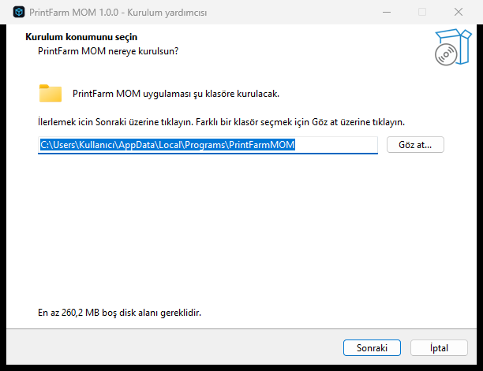

*Kurulum sihirbazının "Kurulum konumunu seçin" ekranı. Varsayılan klasörü
(`...\AppData\Local\Programs\PrintFarmMOM`) olduğu gibi bırakıp **Sonraki** deyin.*

### 1.3 İlk açılış

Program açıldığında boş bir Genel Bakış ekranı ve 0 yazıcı görürsünüz. Veri oluşturmak
için sırayla:

1. **Yazıcılar → Ağda Tara** ile ağdaki yazıcıları ekleyin (bkz. bölüm 5).
2. **Kütüphane → Klasör Ekle** ile modellerinizin bulunduğu klasörü seçin (bölüm 4).
3. **Dilimleyiciler** sayfasında kurulu dilimleyicinizi seçip kaydedin (bölüm 8).

İlk açılışta veritabanı ve önbellek klasörleri otomatik oluşturulur:

```
C:\Users\<kullanıcı>\AppData\Local\PrintFarmMOM\
├─ data\printfarm.db          ← işletme, stok, yazıcı ve kütüphane kayıtları
├─ data\thumbnails\           ← otomatik/elle atanan önizlemeler
├─ data\slices\               ← varsayılan dilimleme çıktıları
└─ printfarm-desktop.log      ← hata kayıtları
```

Model dosyalarınız **kopyalanmaz**; bulundukları klasörde kalır, yalnızca indekslenir.

> **Deneme sürümü:** Program ilk açılışta 30 günlük deneme başlatır. Bu sürede
> tüm özellikler açıktır. Süre bitince program açılmak için lisans ister; lisans
> penceresindeki **makine kodunuzu** satıcıya gönderip `.pfl` dosyası alabilir
> veya lisans anahtarınızla çevrimiçi etkinleştirebilirsiniz (bkz. bölüm 9).

---

## 2. Genel yerleşim

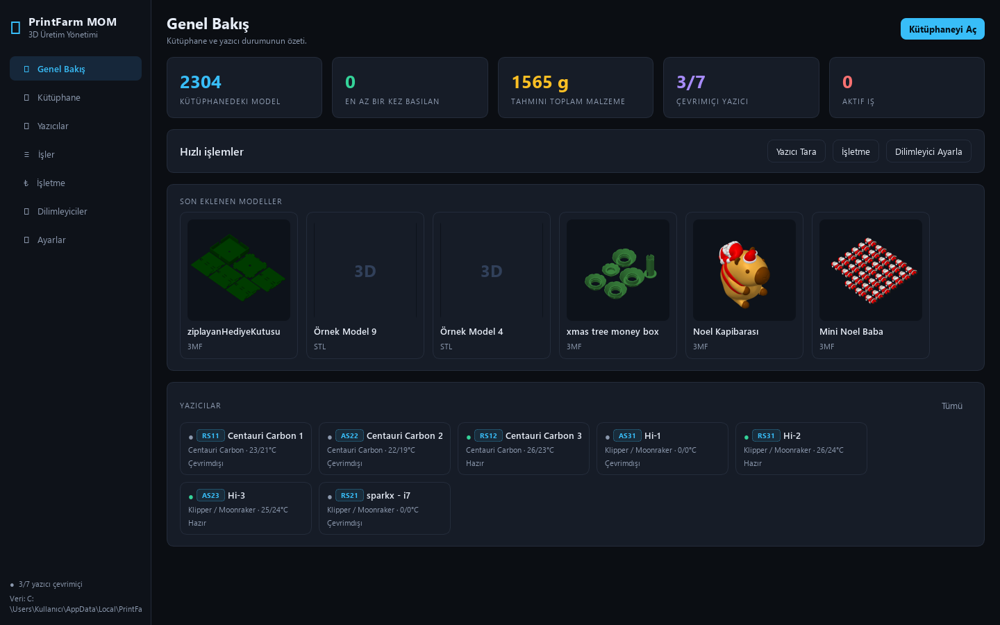

Sol taraftaki sabit menü yedi sayfayı taşır:

| Menü | Ne işe yarar |
|---|---|
| **Genel Bakış** | Kütüphane, yazıcı ve iş özeti; son eklenen modeller |
| **Kütüphane** | STL/3MF/G-code arşivi, önizleme, dilimleme ve gönderme |
| **Yazıcılar** | Ağ taraması, yazıcı kartları, canlı durum ve gömülü panel |
| **İşler** | Kuyruk ve baskı geçmişi |
| **İşletme** | Sipariş, müşteri, ürün, stok, kasa, rapor ve maliyet |
| **Dilimleyiciler** | Dilimleyici keşfi, profil ve çıktı ayarları |
| **Ayarlar** | Maliyet varsayılanları ve yerel veri konumu |

Menünün en altında **çevrimiçi yazıcı sayısı** ve **veri klasörü** görünür.

> Pencere en fazla **1280 × 720** boyutuna kadar küçültülebilir. Kartlar bu genişliğin
> altında sıkışmasın diye daha küçük boyutlandırmaya izin verilmez; ekranınız küçükse
> pencereyi büyütmek yerine bölümleri kaydırarak kullanın.

---

## 3. Genel Bakış

**Genel Bakış**, atölyenin tek bakışta fotoğrafıdır.

- **Kütüphanedeki model:** indekslenmiş toplam dosya sayısı.
- **En az bir kez basılan:** `Yazdırıldı` işaretlenmiş veya baskı sayısı artmış modeller.
- **Tahmini toplam malzeme:** modellerin hesaplanan gramajlarının toplamı.
- **Çevrimiçi yazıcı:** çevrimdışı olmayan yazıcı / toplam yazıcı.
- **Aktif iş:** kuyrukta, gönderilmiş veya basılan iş sayısı.

**Hızlı işlemler** düğmeleri ilgili sayfaya götürür. **Son eklenen modeller** şeridinde
bir karta tıklarsanız model Kütüphane'de seçili açılır; **Yazıcılar** şeridindeki bir
karta tıklarsanız Yazıcılar sayfası açılır. Pencere daraldığında kartlar alt satıra
sarılır, hiçbiri kesilmez.

---

## 4. Kütüphane

Kütüphane, diskteki model dosyalarınızı **yerinde** indeksler; dosya kopyalamaz.
Desteklenen türler: **3MF, STL ve G-code** (`.gcode`, `.gco`, `.g`). 3MF dosyalarının
gömülü önizlemeleri hızla çıkarılır; STL modellerinin ölçü, hacim ve gramaj tahmini
arka planda hesaplanır.

### 4.1 Klasör ekleme ve tarama

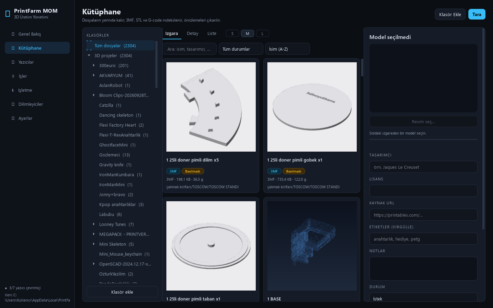

1. Sağ üstteki **Klasör Ekle** (veya sol alttaki **Klasör ekle**) düğmesine basın.
2. Model arşivinizin en üst klasörünü seçin.
3. Tarama otomatik başlar; üstte ince bir ilerleme çubuğu ve dosya adı görünür.

Tarama davranışı:

- Aynı klasör ikinci kez eklenmez; **iç içe klasörler** en dış kökte birleştirilir,
  böylece alt kök boş görünmez.
- Değişen ve yeni dosyalar sonraki taramada yakalanır. **Tara** düğmesi tüm kökleri
  yeniden tarar.
- 50'den fazla dosyalık klasörlerde **hızlı mod** kullanılır: yalnızca 3MF önizlemeleri
  hemen çıkarılır, ağır analizler seçim üzerine yapılır. Detay panelinde
  **Analiz bekliyor** yazıyorsa **Yeniden analiz** ile hesaplayın.
- Tarama sürerken yeni klasör eklerseniz istek reddedilmez, sıraya alınır.

Sol taraftaki **KLASÖRLER** ağacı:

- **Tüm dosyalar** toplam sayıyı gösterir.
- Her kök ve alt klasör, yanındaki üçgenle açılıp kapanır (alt klasörler kapalı başlar).
- Parantez içindeki sayı, o klasör ve altındaki toplam dosya sayısıdır.
- Bir köke sağ tıklayıp **Klasörü kütüphaneden çıkar** diyebilirsiniz; diskteki
  dosyalar silinmez.

### 4.2 Görünümler ve kart boyutu

Üst araç çubuğundaki sekmeler görünümü değiştirir:

- **Izgara:** büyük önizleme kartları; günlük kullanım için en rahat görünüm.
- **Detay:** her satırda daha fazla bilgi ve küçük önizleme.
- **Liste:** en yoğun görünüm; çok sayıda dosyayı hızlı taramak için.

**S / M / L** düğmeleri ızgara kartlarının boyutunu değiştirir. Pencere daraldığında
sütun sayısı otomatik azalır (en az 1 sütun).

### 4.3 Arama, filtre ve sıralama

- **Ara** kutusu isim, tasarımcı ve not alanlarında arar.
- **Durum** filtresi: Tüm durumlar, Hiç basılmadı, İstek, Kuyruk, Basılıyor, Basıldı,
  Başarısız.
- **Sıralama**: İsim (A-Z), Yeni eklenen, En çok basılan, Boyut, Son basım.

### 4.4 Kart sağ tık menüsü

Bir karta sağ tıkladığınızda:

| Komut | Etkisi |
|---|---|
| **Dosyayı aç** | Dosyayı varsayılan uygulamayla açar (ör. dilimleyici) |
| **Yazdırıldı olarak işaretle** | Baskı sayacını artırır ve durumu `Basıldı` yapar |
| **Yeniden analiz et** | Ölçü, hacim, gramaj ve süre tahminini yeniden hesaplar |
| **Resim ata…** | Bu karta kendi resminizi atar (otomatik önizlemenin yerine geçer) |
| **İndeksten çıkar** | Kaydı kütüphaneden siler; **diskteki dosya silinmez** |

### 4.5 Seçili model ve detay paneli

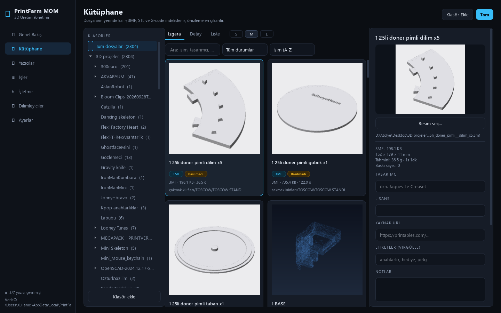

Bir karta veya satıra tıkladığınızda sağdaki panel dolar:

- **Önizleme** ve **Resim seç… / Otomatik önizleme** düğmeleri.
- **Dosya yolu** (tam yol için üzerine gelin), dosya türü, boyut, ölçüler
  (`152 × 179 × 11 mm` gibi), tahmini gram ve süre, baskı sayısı.
- **Tasarımcı**, **Lisans** (CC lisansları veya serbest metin), **Kaynak URL**,
  **Etiketler** (virgülle), **Notlar**, **Durum**.

Değişiklikten sonra **Kaydet** deyin. **Yazdırıldı** düğmesi baskı sayacını artırır.

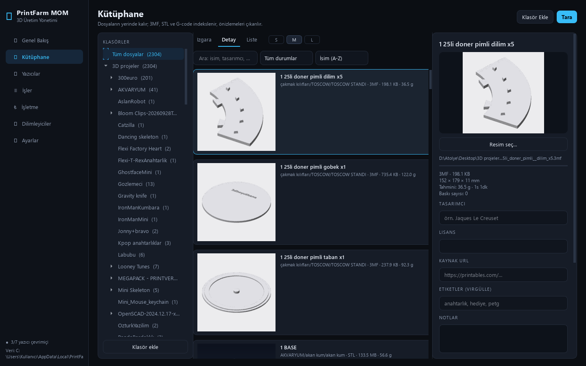

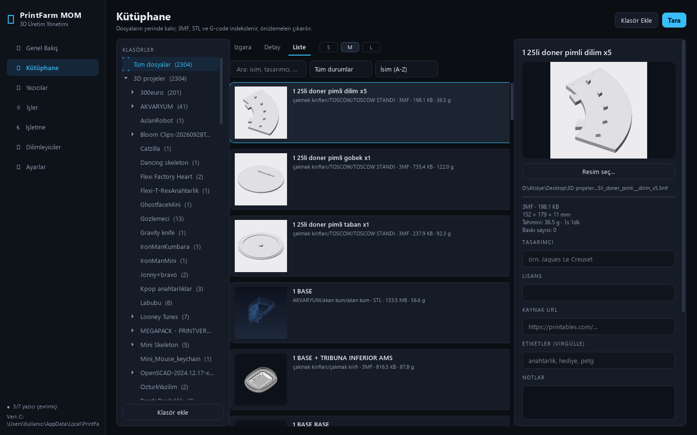

### 4.6 Modele resim atama

Otomatik önizleme her modelde anlamlı olmayabilir (özellikle STL'lerde). Kendi
resminizi atamak için:

- Detay panelinde **Resim seç…** — PNG/JPG seçin. Resim otomatik olarak PNG'ye
  çevrilip önbelleğe alınır ve kartta görünür.
- Karta sağ tıklayıp **Resim ata…** — aynı işlemin kısa yolu.
- **Otomatik önizleme** düğmesi (yalnızca elle resim atanmışsa görünür) elle atanan
  resmi kaldırır ve 3MF/STL önizlemesine döner.

Elle atanan resim, model yeniden analiz edilse bile korunur.

### 4.7 Dilimleme (G-code üretme)

1. Dilimleyiciler sayfasında bir dilimleyici seçip kaydedin (bölüm 8).
2. Kütüphanede modeli seçin, **Dilimle / G-code üret** düğmesine basın.

Dilimleyici, seçtiğiniz makine/proses profilleri ve filament profiliyle çalışır.
Çıktı, ayarlarda **Çıktı klasörü** boşsa modelin yanına; doluysa o klasöre yazılır.
Bambu Studio ve OrcaSlicer için girdi olarak **3MF** dosyası gerekir; STL seçtiyseniz
dilimleyici hata verebilir.

> Dilimleme uzun sürebilir. İşlem arka planda çalışır; arayüz donmaz. Hata olursa
> dilimleyicinin komut çıktısı mesaj kutusunda gösterilir.

### 4.8 Yazıcıya gönder

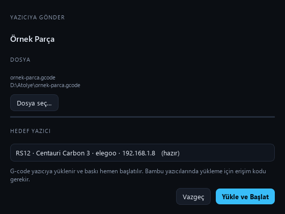

**Yazıcıya Gönder…** düğmesi, modelin yanında (veya ayarlı çıktı klasöründe) aynı adla
başlayan en yeni G-code dosyasını bulur. Diyalogda:

- **Dosya:** otomatik bulunan dosya; **Dosya seç…** ile başka bir G-code seçilebilir.
- **Hedef yazıcı:** açılır listede her yazıcının durumu parantez içinde (hazır, basıyor,
  çevrimdışı…). Varsayılan olarak hazır olan ilk yazıcı seçilir.
- **Yükle ve Başlat:** dosya yazıcıya yüklenir ve baskı hemen başlatılır.

Bambu yazıcılarında yükleme için yazıcının **erişim kodu** gerekir. Gönderim kaydı
**İşler** sayfasına düşer.

### 4.9 Model durum akışı

| Durum | Anlamı |
|---|---|
| İstek | Basılması istenen, henüz sıraya alınmamış model |
| Kuyruk | Baskı sırasına alınmış |
| Basılıyor | Şu anda baskıda |
| Basıldı | En az bir kez başarıyla basıldı |
| Başarısız | Baskı başarısız oldu |

---

## 5. Yazıcılar

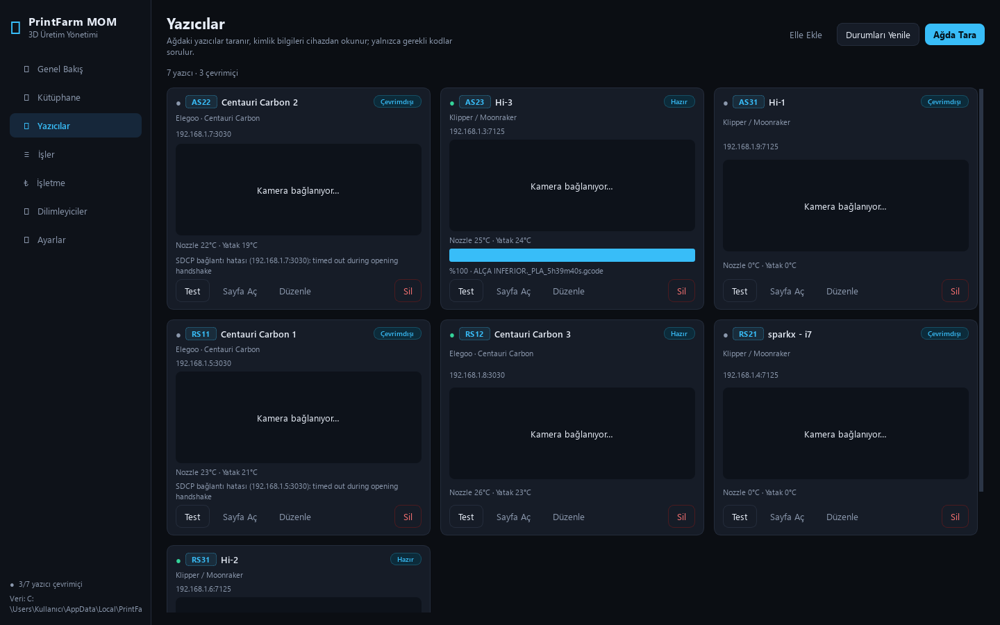

### 5.1 Ağda Tarama

**Ağda Tara** düğmesi, yerel ağdaki yazıcı yönetim sistemlerini sırayla arar:

- **Klipper / Moonraker** (Fluidd, Mainsail) — 7125
- **Elegoo SDCP** (Centauri Carbon) — 3030
- **Bambu Lab**, **Prusa**, **Creality**, **Snapmaker** arayüzleri

Diyalogda **Taramayı Başlat** deyin. **Derin tarama (tüm ağ)** işaretliyse alt ağdaki
tüm adresler denenir; kapalıysa yalnızca yaygın adresler taranır. Bulunan yazıcılar
marka, model, adres ve bilgi sütunlarıyla listelenir. Kimlik bilgisi gerektirmeyenler
otomatik eklenir; gerekenler için bilgi sütunundaki notu izleyin.

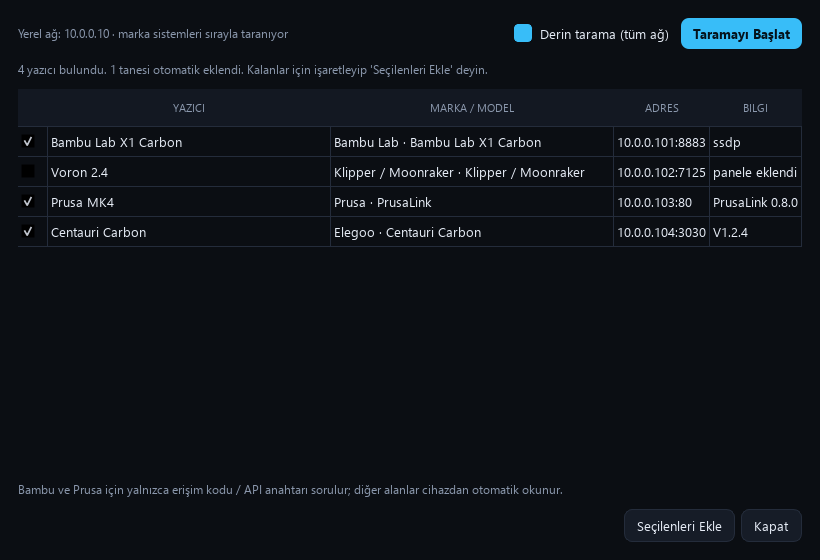

*Örnek tarama sonucu. Kimlik bilgisi gerektirmeyen yazıcılar (Voron 2.4 gibi) "panele
eklendi" notuyla otomatik eklenir ve işareti kaldırılır; Bambu, Prusa ve Elegoo için
satırı işaretleyip **Seçilenleri Ekle** dediğinizde erişim kodu / API anahtarı sorulur.*

### 5.2 Elle yazıcı ekleme

Otomatik tarama bir yazıcıyı bulamazsa **Elle Ekle** ile marka, model, adres, port ve
kimlik bilgilerini kendiniz girebilirsiniz. Bu yol, özel port veya kullanıcı adı
gerektiren kurulumlar içindir. İsterseniz aynı ekranda yazıcının fiziksel etiket
kodunu da (**Kod** alanı) girebilirsiniz; ayrıntısı bölüm 5.5'tedir.

### 5.3 Yazıcı kartları

Her kartta:

- Renkli durum noktası ve durum rozeti: **Hazır**, **Basıyor**, **Duraklatıldı**,
  **Hata**, **Bakımda**, **Çevrimdışı**
- Yazıcıya kod verilmişse adın önünde renkli **kod rozeti** (örn. `RS11`)
- Marka / model, `IP:port`
- Kamera yayını (destekleniyorsa) — yoksa kısa bir açıklama
- Nozzle ve yatak sıcaklıkları
- Baskı sırasında ilerleme çubuğu, dosya adı, kalan dakika

**Kamera notu:** Elegoo kameraları doğrudan MJPEG akışıyla kartta görünür. Creality Hi
gibi yazıcılar kamerayı yalnızca H.264 WebRTC ile yayınlar; bu görüntü Edge (Chromium)
üzerinden alınır ve Windows'ta hazır gelen Microsoft Edge kullanılır. Kamera ancak
**Test** başarılı olup kamera bulunduğunda görünür; görüntü kartta ve yazıcı panelinin
üstündeki canlı şeritte yaklaşık saniyede iki kare hızında yenilenir.

Karttaki düğmeler:

| Düğme | Etkisi |
|---|---|
| **Test** | Bağlantıyı dener ve kamerayı kontrol eder |
| **Sayfa Aç** | Yazıcının kendi arayüzünü uygulama içinde açar |
| **Düzenle** | Yazıcının adını ve fiziksel etiket kodunu değiştirir |
| **Sil** | Yazıcıyı listeden kaldırır (yazıcıya bir şey olmaz) |

Karta tıklamak da **gömülü paneli** açar: yazıcının web arayüzü (Fluidd/Mainsail/Elegoo/
Bambu) uygulama içinde, geri/ileri/yenile düğmeleriyle görünür. Aynı yazıcı için tek
panel açılır. Panelin üstündeki **Tarayıcıda Aç** ile dış tarayıcıya geçebilirsiniz.

**Durumları Yenile** tüm yazıcıların sıcaklık, ilerleme ve durum bilgisini yeniden
sorgular. Sayfa açıldığında bu işlem otomatik de yapılır.

### 5.4 Kamera desteği (Elegoo ve Creality)

Yazıcı kameraları iki farklı yöntemle yayın yapar; PrintFarm MOM ikisini de destekler:

| Marka / tür | Yayın biçimi | Görüntü nasıl alınır | Nerede görünür |
|---|---|---|---|
| **Elegoo** (Centauri Carbon vb.) | MJPEG akışı, `http://<ip>:3031/video` | Doğrudan akış okunur | Kart ve panel |
| **Creality Hi / Klipper klonu** | Yalnızca H.264 WebRTC, `http://<ip>:8000/` | Microsoft Edge (Chromium) arka planda açar, kareler yakalanır | Kart ve panel |

**Önemli ayrıntılar:**

- Creality'nin H.264 yayını, uygulamanın gömülü tarayıcısı (QtWebEngine) tarafından
  çözülemez. Bu nedenle görüntü, Windows ile birlikte gelen **Microsoft Edge** üzerinden
  alınır. Edge kurulu değilse kamera yerine "Kamera açılamadı: Microsoft Edge bulunamadı"
  yazar; Edge'i kurup tekrar **Test** deyin.
- Kamera, ancak kartta **Test** başarılı olup kamera bulunduğunda gösterilir. Test bir kez
  yapılır; sonuç kaydedilir, program yeniden açıldığında kamera kendiliğinden gelir.
- Görüntü yaklaşık **saniyede iki kare** hızında yenilenir. Bu bilinçli bir tercihtir:
  Creality kamerası tek izleyiciye yayın yaptığı için ağ ve yazıcı yükü düşük tutulur.
- Yazıcı kartındaki kamera ile **Sayfa Aç** paneli aynı kameraya iki ayrı bağlantı
  açmaz: panel açılınca karttaki akış durur, panel kapanınca yeniden başlar.
- Kartta kamera kutusu boşsa önce yazıcının kendi web arayüzünde kameranın açık
  olduğunu doğrulayın (`http://<ip>:8000/` tarayıcıda açılmalı).

### 5.5 Yazıcı kodu (raf / sıra etiketi)

Farmdaki her yazıcıya, kasada yapıştırdığınız fiziksel etiketin aynısını programda da
verebilirsiniz: **RS11**, **AS22** gibi raf–sıra–yer bilgisini taşıyan kısa kodlar.

- Kodu girmek için karttaki **Düzenle** düğmesini kullanın ya da **Elle Ekle** ekranındaki
  **Kod** alanını doldurun. Kod, ad ile birlikte kaydedilir.
- Kod küçük harfle girilse bile **otomatik büyük harfe** çevrilir ve aradaki boşluklar
  atılır (`rs 11` → `RS11`). En fazla 20 karakter; harf, rakam, nokta, tire ve alt çizgi
  kullanılabilir. Boş bırakılabilir.
- Aynı kod iki yazıcıya verilemez; çakışma olursa uyarı gösterilir.
- Kod girilen yazıcılar listede **başa alınır** ve kartta, pano başlığında, gösterge
  panelinde, **İşler** tablosunda ve gönderim listesinde adın önünde rozet olarak görünür.
  Böylece "RS11'e gönder" derken listede arama yapmanız gerekmez; arama kutusu kodu da arar.

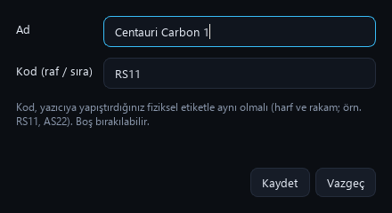

*Karttaki **Düzenle** düğmesi adı ve kodu birlikte değiştirmenizi sağlar. Kod alanına
yapıştırdığınız etiketin aynısını yazın; kaydettiğinizde kartta rozet olarak görünür.*

---

## 6. İşler

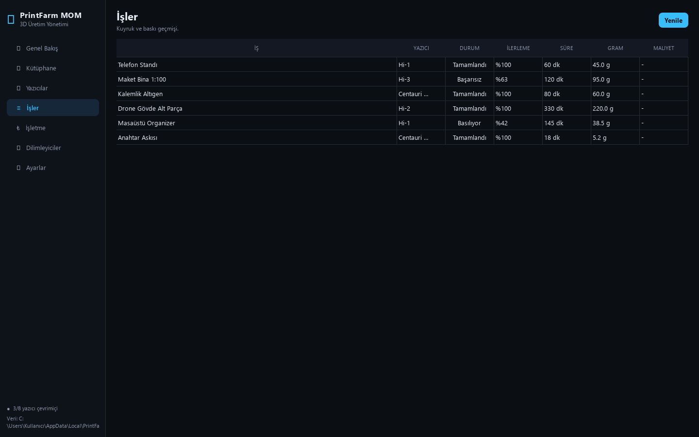

İşler sayfası iki kaynağı birleştirir:

1. **Masaüstü gönderimleri** — Kütüphane'den **Yazıcıya Gönder** ile yapılan yüklemeler
   (`Yükleniyor`, `Basılıyor`, `Tamamlandı`, `Başarısız`, `İptal`).
2. **Web/kuyruk işleri** — veritabanındaki `jobs` kayıtları (`Kuyrukta`, `Gönderildi`,
   `Basılıyor`, `Duraklatıldı`, `Tamamlandı`, `Başarısız`, `İptal`).

Sütunlar: **İş**, **Yazıcı**, **Durum**, **İlerleme**, **Süre**, **Gram**, **Maliyet**.
Durumun üzerine gelince varsa hata mesajı görünür. **Yenile** listeyi tazeler; sayfaya
her girişte de otomatik yenilenir. Liste en yeni 300 kaydı gösterir.

---

## 7. İşletme

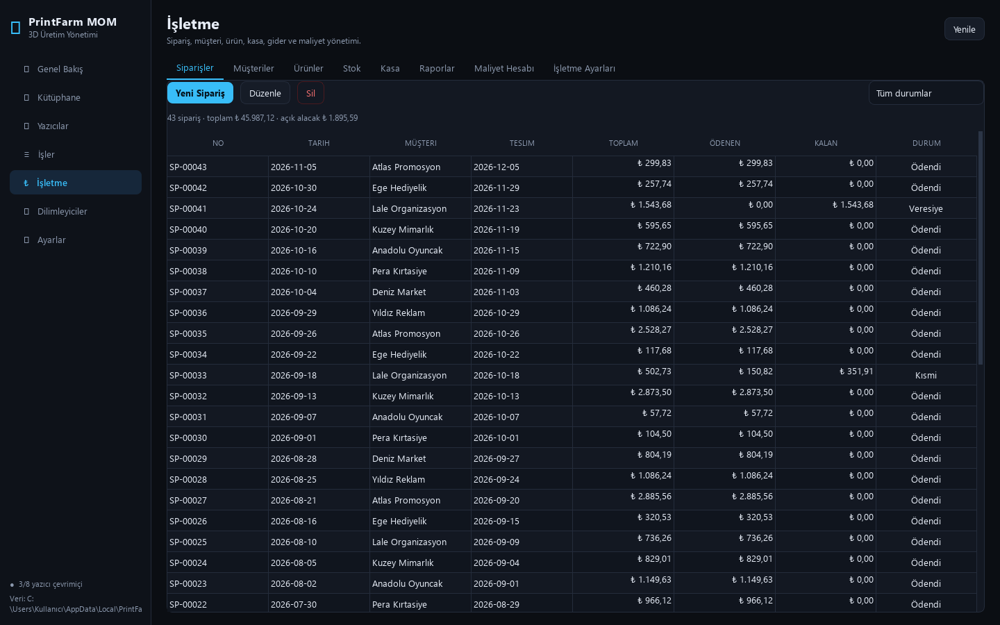

İşletme sekmesi, PrintFarm MOM'u bir atölye yönetim programına çevirir. Sekiz alt
sekmesi vardır: **Siparişler, Müşteriler, Ürünler, Stok, Kasa, Raporlar, Maliyet
Hesabı, İşletme Ayarları**. Sağ üstteki **Yenile** tüm sekmeleri tazeler.

### 7.1 Siparişler

- **Yeni Sipariş** — müşteri (istenirse **Yeni müşteri…** ile anında eklenir), sipariş ve
  teslim tarihi, sipariş iskontosu, alınan ödeme ve not girilir.
- **Ürün satırı ekle** — her satırda ürün, adet, **Toptan/Perakende** fiyat tipi, birim
  fiyat ve satır iskontosu bulunur. Ürün seçildiğinde fiyat, ürünün maliyet ve kâr
  payından otomatik hesaplanır; isterseniz elle değiştirebilirsiniz.
- Sipariş kaydedilirken ürün stoğu satır adetleri kadar **otomatik düşer** ve stok
  hareket defterine yazılır. Düzenleme/silmelerde eski satırların stoğu geri eklenir.
- Durum, ödenen tutara göre otomatik belirlenir: **Ödendi**, **Kısmi**, **Veresiye**.
- Liste filtresi bu üç duruma göre süzer. Özet satırı toplam sipariş, toplam tutar ve
  açık alacağı gösterir.
- Sipariş numarası `SP-00001` biçimindedir; satıra çift tıklayınca düzenleme açılır.

> Sipariş diyaloğu tam hâliyle:
>
> 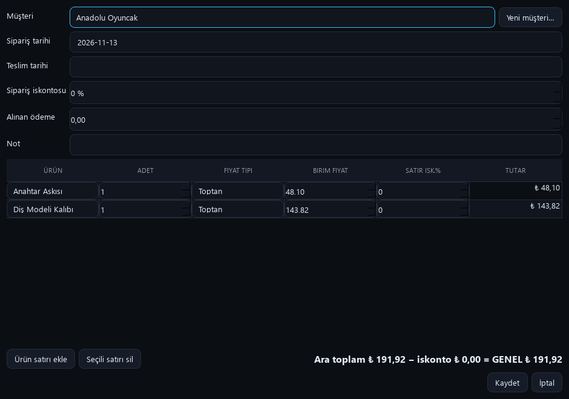

### 7.2 Müşteriler

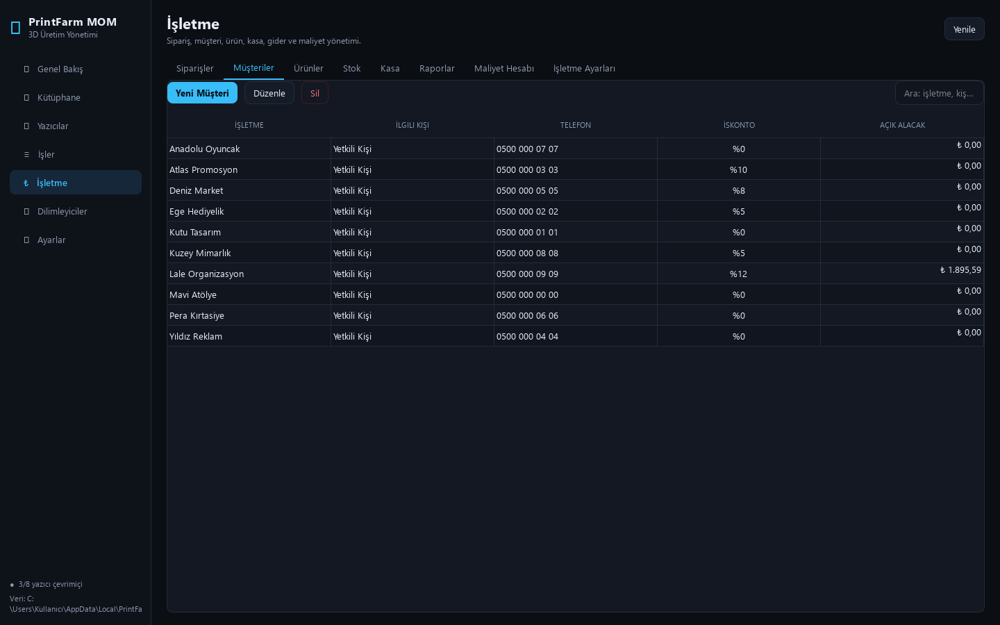

Alanlar: **İşletme/Ad**, **İlgili kişi**, **Telefon**, **E-posta**, **Adres**,
**Sürekli iskonto (%)**, **Not**. Tabloda her müşterinin iskontosu ve **açık alacağı**
görünür; arama kutusu işletme, kişi ve telefon alanlarında arar. Müşteri silindiğinde
sipariş kayıtları silinmez, adları üzerinde kalır.

### 7.3 Ürünler

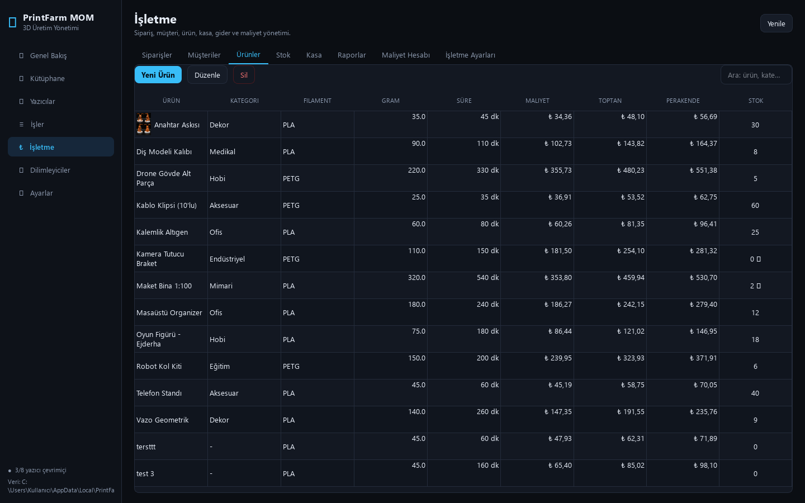

Ürün kartı, maliyet motorunun temelidir. Alanlar:

| Alan | Açıklama |
|---|---|
| Ürün adı, kategori, filament | Katalog bilgisi |
| Gramaj, baskı süresi | Malzeme, elektrik ve amortisman hesabı |
| Ek maliyet | Ambalaj, etiket gibi parça başı gider |
| Toptan / perakende kâr payı | Maliyetin üzerine eklenecek yüzde |
| İşçilik payı | 0 ise İşletme Ayarları'ndaki varsayılan kullanılır |
| Stok, minimum stok | Siparişte düşer; minimumun altında ⚠ uyarısı çıkar |
| Barkod, not | Serbest alanlar |

Diyalogdaki **Resim seç… / Resmi kaldır** ile ürüne görsel eklenebilir; görsel ürün
tablosunda satır ikonu olarak görünür. Tablo maliyet, toptan ve perakende fiyatları
canlı hesaplar.

### 7.4 Stok

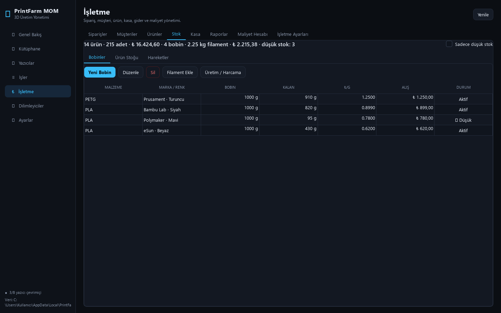

Stok sekmesi üç alt sekmedir. Üstteki özet satırı toplam ürün adedi, ürün stok değeri,
bobin sayısı, toplam filament kilogramı, toplam değer ve düşük stok sayısını gösterir.
**Sadece düşük stok** kutusu yalnızca eşiğin altındaki kayıtları bırakır.

**Bobinler** — filamentin gerçek takibi:

| Düğme | İşlev |
|---|---|
| **Yeni Bobin** | Malzeme, marka, renk, bobin ağırlığı, kalan gram, alış fiyatı, düşük stok eşiği |
| **Düzenle** | Bobin bilgilerini günceller |
| **Sil** | Bobini kaldırır |
| **Filament Ekle** | Mevcut bobine gram ekler (yeni alım / tamamlama) |
| **Üretim / Harcama** | Bobinden gram düşer; sebep ve tarih kaydedilir |

Her bobinin **₺/g** değeri alış fiyatı / bobin ağırlığıdır. Ürün maliyeti hesaplanırken
malzemenin bobinleri varsa bunların kalan grama göre **ağırlıklı ortalama** fiyatı
kullanılır; bobin yoksa İşletme Ayarları'ndaki birim fiyat geçerlidir.

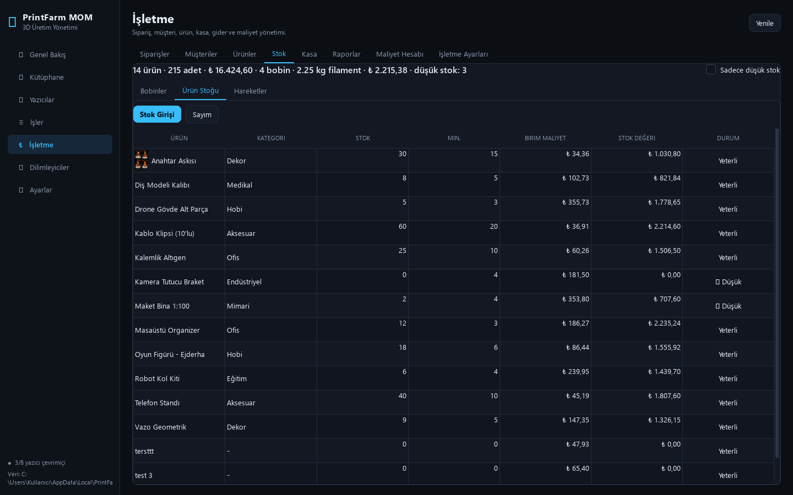

**Ürün Stoğu** — ürünlerin adet bazlı stoğu:

- **Stok Girişi:** ürün, miktar, tarih ve not ile stok ekler.
- **Sayım:** ürünün mevcut stoğunu sayılan değere eşitler; fark hareket defterine
  "sayım" olarak yazılır.
- Tabloda birim maliyet, stok değeri ve durum (yeterli/düşük) görünür.

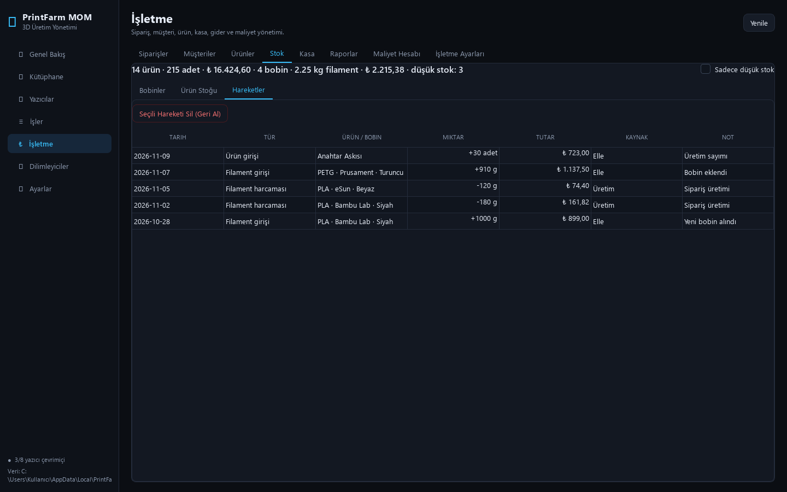

**Hareketler** — tüm stok değişimlerinin defteri. Sütunlar: tarih, tür, ürün/bobin,
miktar, tutar, kaynak ve not. Türler: ürün girişi, ürün çıkışı, ürün sayımı, filament
girişi, filament harcaması, filament sayımı, sipariş çıkışı. **Seçili Hareketi Sil
(Geri Al)** yanlış girilen hareketi geri alır.

### 7.5 Kasa

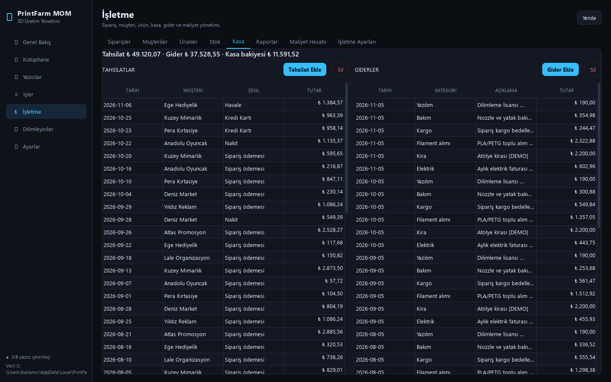

Kasa iki panelden oluşur:

- **TAHSİLATLAR:** bağımsız tahsilatlar **ve sipariş anında alınan ödemeler**. Üstte
  tahsilat toplamı, gider toplamı ve **kasa bakiyesi** yazar.
- **GİDERLER:** kategori, açıklama ve tutar.

**Tahsilat Ekle** ile müşteri, tarih, tutar, ödeme şekli (Nakit, Havale, Kredi Kartı…)
ve not girilir. Tahsilat, müşterinin en eski açık siparişlerinden başlayarak FIFO
sırasıyla kapatılır. Sipariş ödemesi satırları buradan silinemez; düzeltmek için
siparişi düzenleyin. **Gider Ekle** ile tarih, kategori, açıklama ve tutar girilir.

### 7.6 Raporlar

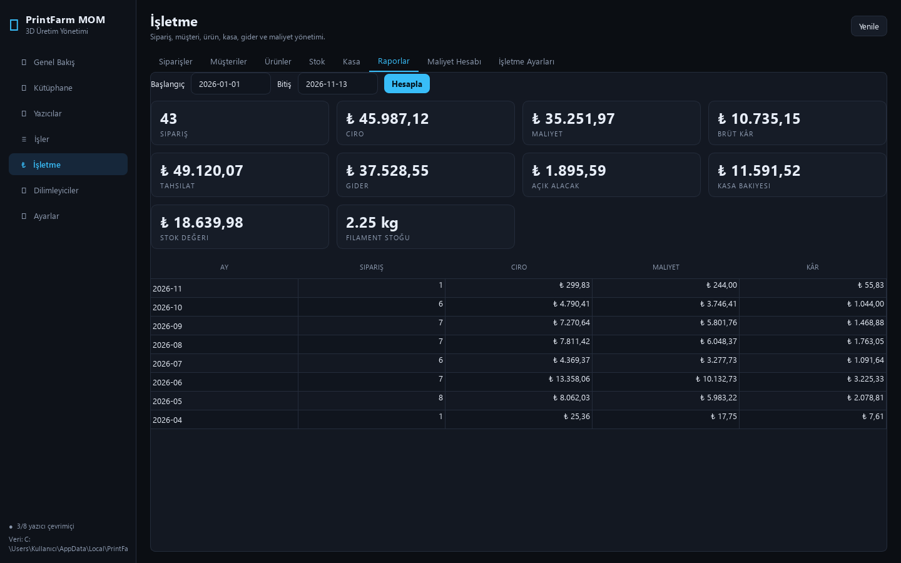

**Başlangıç** ve **Bitiş** tarihleri arasında (varsayılan: yılbaşı – bugün) **Hesapla**
diyin. Kutucuklar:

- Sipariş sayısı, ciro, maliyet, brüt kâr
- Tahsilat, gider, açık alacak, kasa bakiyesi
- Stok değeri ve filament stoğu (kg)

Alt tabloda aylık kırılım (sipariş, ciro, maliyet, kâr) listelenir. Tarihleri
`YYYY-AA-GG` biçiminde girin.

### 7.7 Maliyet Hesabı

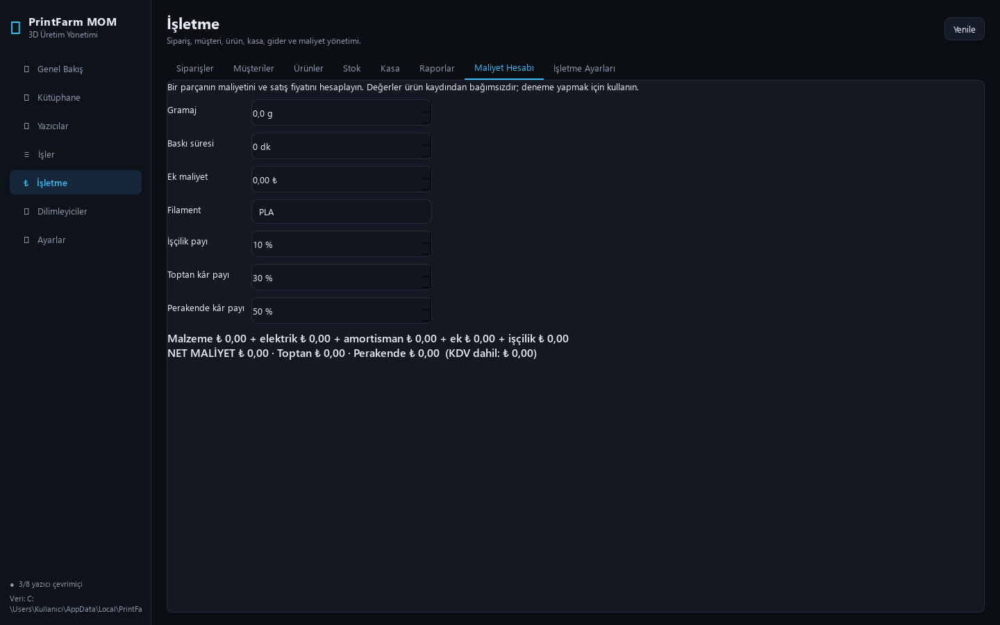

Ürün kaydından bağımsız, hızlı hesap aracı. **Gramaj**, **baskı süresi**, **ek maliyet**,
**filament**, **işçilik payı**, **toptan** ve **perakende kâr payı** girilir; sonuç anında
güncellenir:

```
Malzeme + elektrik + amortisman + ek maliyet + işçilik = NET MALİYET
Toptan  = net maliyet × (1 + toptan kâr payı)
Perakende = net maliyet × (1 + perakende kâr payı)
KDV dahil perakende ayrıca gösterilir
```

Elektrik = dakika × makine gücü (kW) × ₺/kWh ÷ 60; amortisman = dakika × ₺/dakika.

### 7.8 İşletme Ayarları

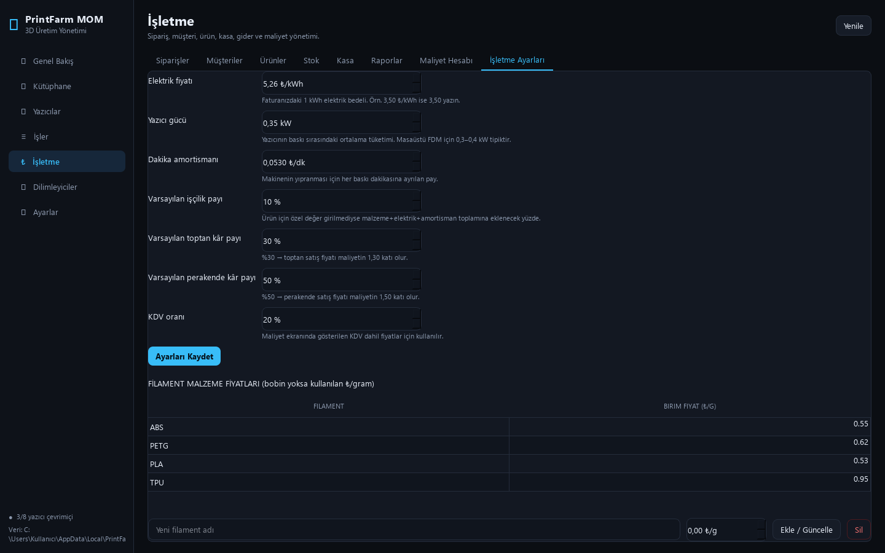

Maliyet motorunun varsayılanları:

| Ayar | Açıklama |
|---|---|
| Elektrik fiyatı (₺/kWh) | Faturadaki birim fiyat |
| Yazıcı gücü (kW) | Baskı sırasındaki ortalama tüketim (masaüstü FDM için 0,3–0,4) |
| Dakika amortismanı (₺/dk) | Makine yıpranması için dakika başına pay |
| Varsayılan işçilik payı (%) | Ürün özelinde değer yoksa kullanılır |
| Varsayılan toptan / perakende kâr payı (%) | Ürün varsayılanları |
| KDV oranı (%) | KDV dahil fiyat gösterimi |

**Ayarları Kaydet** ile saklayın. Alttaki **FİLAMENT MALZEME FİYATLARI** tablosu, bobin
yokken kullanılacak ₺/g fiyatlarını tutar; ad yazıp **Ekle / Güncelle** veya **Sil**
diyin.

---

## 8. Dilimleyiciler

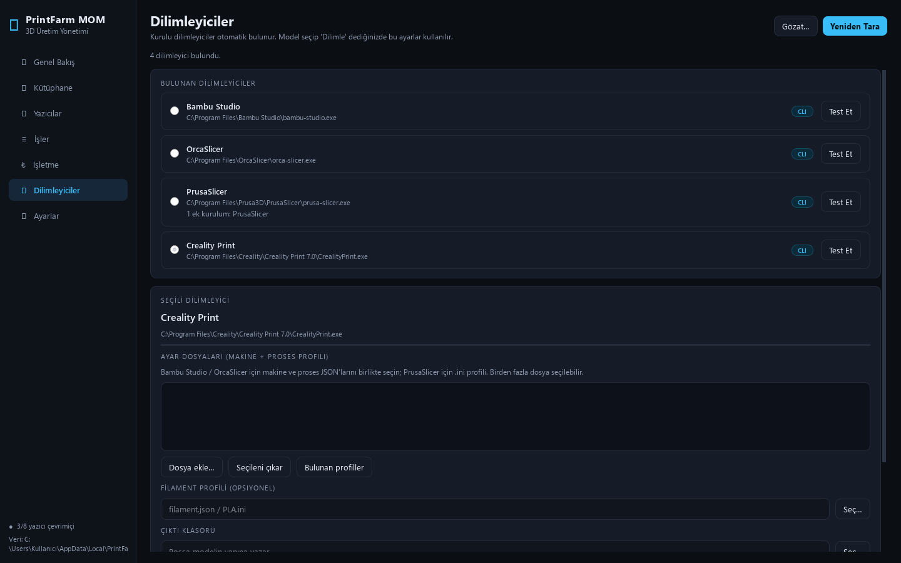

Uygulama açılışta kurulu dilimleyicileri otomatik arar: Bambu Studio, OrcaSlicer,
PrusaSlicer, Cura, Creality Print. Bulunanlar kart olarak listelenir; aynı programın
birden fazla kurulumu varsa "ek kurulum" satırında gösterilir.

1. Kullanmak istediğiniz dilimleyicinin yanındaki radyo düğmesini seçin (veya **Gözat…**
   ile `.exe` dosyasını elle gösterin).
2. **AYAR DOSYALARI:** Bambu Studio ve OrcaSlicer için **makine + proses** JSON'larını
   birlikte seçin; PrusaSlicer için `.ini`. Birden fazla dosya eklenebilir.
   **Bulunan profiller** dilimleyicinin kullanıcı profillerini arar.
3. **FİLAMENT PROFİLİ (opsiyonel):** filament JSON/INI dosyası.
4. **ÇIKTI KLASÖRÜ:** boşsa G-code modelin yanına yazılır.
5. **KOMUT ŞEMASI** alanında seçili dilimleyiciye gönderilecek komutun taslağını görürsünüz.
6. **Kaydet** ve ardından **Ayarları Test Et** ile dilimleyicinin çalıştığını doğrulayın.

**Yeniden Tara** listeyi tazeler. Dilimleyici bulunamazsa Kütüphane'de dilimleme
çalışmaz; **Gözat…** ile yolu elle gösterebilirsiniz.

---

## 9. Ayarlar

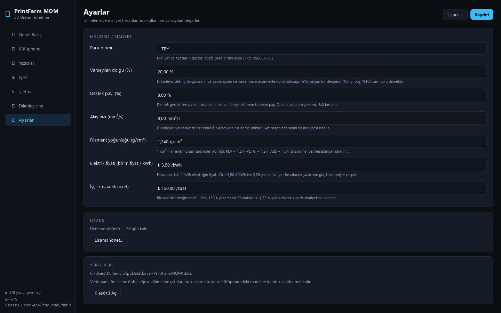

**MALZEME / MALİYET** bölümü dilimleme ve maliyet tahminlerinde kullanılan genel
değerleri tutar:

| Ayar | Açıklama |
|---|---|
| Para birimi | TRY, USD, EUR… Fiyat ön ekini belirler |
| Varsayılan dolgu (%) | Dilimleyici iç dolgu oranı (yaygın: %15) |
| Destek payı (%) | Destek gereken parçalarda malzeme/süre payı |
| Akış hızı (mm³/s) | Tahmini baskı süresi hesabı |
| Filament yoğunluğu (g/cm³) | PLA ≈ 1,24 · PETG ≈ 1,27 · ABS ≈ 1,04 |
| Elektrik fiyatı (₺/kWh) | Tahmini maliyet |
| İşçilik (saatlik ücret) | Saatlik emek bedeli |

**Kaydet** ile saklayın. **YEREL VERİ** bölümü veritabanının tam yolunu gösterir;
**Klasörü Aç** bu klasörü Windows Gezgini'nde açar.

> Ayarlar sayfasındaki elektrik ve işçilik, *tahmini maliyet* içindir. İşletme
> modülünün gerçek fiyatlandırması **İşletme → İşletme Ayarları**'ndadır.

### 9.1 Lisans

**LİSANS** bölümü lisansın durumunu gösterir; **Lisansı Yönet…** (veya üst
çubuktaki **Lisans…**) penceresini açar. Pencerede:

| Öğe | Ne işe yarar |
|---|---|
| Durum satırı | Lisanslı / deneme (kalan gün) / süre doldu |
| Makine kodu | Bu bilgisayara özgü `XXXX-XXXX-XXXX-XXXX` kod. **Kopyala** ile alın; satıcıya gönderin |
| Lisans Dosyası Yükle… | Satıcıdan gelen `.pfl` dosyasını seçip etkinleştirin |
| Online aktivasyon | Lisans anahtarını girip **Etkinleştir**'e basın (satıcı bu hizmeti açtıysa) |

Lisans bu bilgisayara bağlıdır; başka bilgisayar için düzenlenmiş dosya kabul
edilmez. Donanım değişikliği (disk değişimi, Windows yeniden kurulumu) makine
kodunu değiştirebilir; bu durumda yeni lisans isteyin.

> Lisans dosyasını yedekleyin. Programı kaldırıp yeniden kurmak lisansı silmez
> (`license.pfl`, `%LOCALAPPDATA%\PrintFarmMOM` klasöründedir) ama disk
> biçimlendirmede kaybolur.

### 9.2 Hakkında ve iletişim

**Ayarlar → Hakkında…** penceresi programın logosunu, sürüm numarasını, lisans
durumunu ve makine kodunu gösterir. Altındaki **LİSANS VE DESTEK** bölümünde
satıcının web sitesi, Instagram adresi ve e-posta adresi tıklanabilir bağlantı
olarak yer alır; **Kullanım Kılavuzu** düğmesi bu kılavuzu açar.

Lisans penceresinde de aynı iletişim bilgileri görünür; deneme süresi dolduğunda
açılan zorunlu pencereden doğrudan satıcıya ulaşabilirsiniz.

---

## 10. Veri, yedekleme ve taşıma

Tüm kayıtlar tek bir SQLite dosyasındadır:

```
%LOCALAPPDATA%\PrintFarmMOM\data\printfarm.db
```

**Yedekleme (önerilen):**

1. Programı kapatın.
2. `%LOCALAPPDATA%\PrintFarmMOM` klasörünün tamamını kopyalayın (ör. harici diske veya
   OneDrive'a).
3. Geri yüklemek için program kapalıyken klasörü aynı konuma geri kopyalayın.

**Başka bilgisayara taşıma:** aynı klasörü yeni bilgisayarda
`%LOCALAPPDATA%\PrintFarmMOM` altına kopyalayın. Model dosyalarınız ayrı bir klasördeyse
o klasörü de taşıyıp Kütüphane'de yeniden ekleyin; yollar değişirse tarama yeni konumu
indeksler (notlar ve etiketler kaybolabilir, dosya adları eşleşiyorsa korunur).

**Gelişmiş:** `PRINTFARM_HOME` ortam değişkeni ile veri klasörü başka bir yere
yönlendirilebilir.

Kurulumu kaldırmak (`Ayarlar → Uygulamalar → PrintFarm MOM → Kaldır`) program
dosyalarını siler; **veri klasörü korunur**. Tamamen temizlik için yukarıdaki klasörü
elle silin.

---

## 11. Sorun giderme

| Belirti | Çözüm |
|---|---|
| **"database is locked"** | Başka bir kopya açık olabilir; yalnızca bir pencere çalıştırın. Programı kapatıp yeniden açın. |
| **Yazıcı taramada bulunamıyor** | Yazıcıyla aynı ağda olduğunuzu doğrulayın; **Derin tarama**'yı açın; yazıcının web arayüzü tarayıcıda açılıyor mu bakın. |
| **Bambu yazıcıya gönderim başarısız** | Yazıcının ekranındaki **erişim kodu**nu Elle Ekle ekranına girin; LAN modu açık olmalı. |
| **Dilimleyici bulunamadı** | Dilimleyiciler sayfasında **Gözat…** ile `.exe` yolunu seçin. |
| **Dilimleme hata veriyor** | Bambu Studio/OrcaSlicer 3MF ister; makine + proses JSON'larının ikisini de ekleyin. |
| **STL'de ölçü/gramaj yok** | Hızlı modda ağır analiz ertelenir; **Yeniden analiz** deyin. |
| **Kartlar görünmüyor / pencere küçülmüyor** | Pencere en az 1280 × 720'dir; ekran çözünürlüğünüz daha küçükse ölçeklendirmeyi %100'e alın. |
| **Stok beklediğiniz gibi değil** | İşletme → Stok → **Hareketler**'de son hareketlere bakın; yanlış kaydı **Seçili Hareketi Sil (Geri Al)** ile geri alın. |
| **Creality kamerası görünmüyor** | Kartta **Test**'e basın. Ayrıca yazıcının web arayüzü tarayıcıda açılıyor mu (`http://<ip>:8000/`) ve kamerada görüntü var mı kontrol edin. Kamerayı aynı anda başka bir program (Creality Print/Fluidd) izliyorsa kapatın; kamera tek izleyici kabul eder. |
| **"Kamera açılamadı: Microsoft Edge bulunamadı"** | Microsoft Edge'i kurun ve **Test**'i yeniden çalıştırın. Edge Windows'ta hazır gelir; kaldırılmışsa yeniden yüklenmesi gerekir. |
| **Program açılmıyor** | `%LOCALAPPDATA%\PrintFarmMOM\printfarm-desktop.log` dosyasındaki son satırlara bakın. |
| **SmartScreen "bilinmeyen yayıncı" uyarısı** | Program imzasız olduğu için normaldir: **Ek bilgi → Yine de çalıştır**. Uyarıdan çekiniyorsanız `SHA256SUMS.txt` ile dosya özetini karşılaştırın. |

---

## 12. Kısa yol haritası

| İş | Yol |
|---|---|
| Yazıcıları ekle | Yazıcılar → Ağda Tara |
| Model arşivini ekle | Kütüphane → Klasör Ekle |
| Dilimleyici seç | Dilimleyiciler → radyo → Kaydet |
| Model dilimle ve bas | Kütüphane → model → Dilimle → Yazıcıya Gönder |
| Baskı geçmişi | İşler |
| Sipariş gir | İşletme → Siparişler → Yeni Sipariş |
| Filament düş | İşletme → Stok → Bobinler → Üretim / Harcama |
| Aylık kâr | İşletme → Raporlar → Hesapla |
| Yedek al | Programı kapat → `%LOCALAPPDATA%\PrintFarmMOM` klasörünü kopyala |

---

*PrintFarm MOM 1.1.0 — 3D Üretim Yönetimi*
